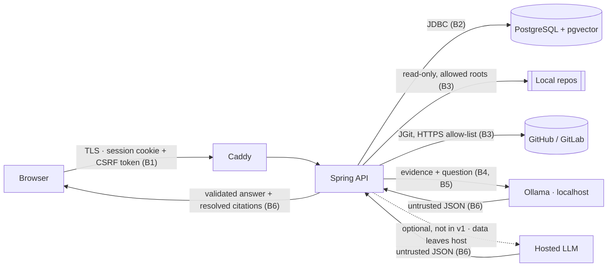

# DevMind AI — Threat Model (v0)

Date: 2026-11-07 · Method: STRIDE per trust boundary · Scope: v1 (M1–M6) · Status: v0. Update it in any PR that adds an input, an external call or a tool (SEC-11).

## 1. Assets
- Indexed source code (public repos in v1), embeddings, conversations, analysis reports
- User accounts and sessions
- Hosted LLM API key and spend budget. Not present in v1, which is local-only ([ADR-0006](adr/0006-ai-provider-port.md)); applies only if a hosted provider is configured.
- Host machine (filesystem outside allowed roots, CPU/RAM/disk)
- Integrity of answers and impact reports. A wrong answer that looks evidenced is a harm of its own, because users act on it.

## 2. Actors
- Authenticated user (may be curious about, or malicious toward, other users' projects)
- Anonymous internet user (if a demo is deployed)
- Malicious repository author (controls file names, contents, comments, history, `.gitattributes`, repo size)
- Third-party model provider (receives evidence snippets). Only if a hosted provider is configured; not in v1.
- Operator (trusted; runs the evaluation harness and mutation runs locally)

## 3. Trust boundaries & data flows
1. Browser ↔ Caddy (TLS) ↔ Spring API
2. API ↔ PostgreSQL
3. API ↔ local filesystem (allowed roots) / Git remotes (HTTPS)
4. API ↔ Ollama (localhost). Optional: hosted LLM (third party, data leaves the machine), not used in v1.
5. Repository content → prompts (untrusted data crossing into model context)
6. Model output → API → browser (untrusted output crossing back into the application and UI)

## 4. Threats
| ID | Threat | STRIDE | Entry point | Mitigation | Rules | Verified by |
|---|---|---|---|---|---|---|
| T1 | Path traversal / symlink escape reads files outside allowed root | I, T | local ingestion | `toRealPath()` + `startsWith(allowedRoot)` for the root and every file; reject escaping symlinks; allowed roots only from server config | SEC-2 | traversal + symlink tests (M2) |
| T2 | SSRF / internal network access via repository URL | I | remote ingestion | HTTPS only, host allow-list, no IP literals, no credentials in URLs, no cross-host redirects | SEC-3 | URL validation tests (M2) |
| T3 | Resource exhaustion via huge repo, many files, giant files, deep history | D | ingestion | shallow clone, no submodules/LFS, size/file/time limits, per-file cap, per-job temp dir | SEC-3, ERR-6 | limit tests (M2) |
| T4 | Prompt injection via code/comments/README makes the model lie or leak instructions | T, I | prompt assembly | `<evidence>` delimiting, system rule that evidence is data, no tools in Q&A, output schema + citation validation | AI-5, AI-6, AI-7, AI-3 | injection benchmark cases q019/q020 (M4) |
| T5 | Secrets in a repo sent to the model provider or stored | I | indexing | secret-file exclusion, regex/entropy redaction before persistence, redaction count visible | SEC-5 | redaction tests (M2) |
| T6 | Cross-tenant access by guessing/reusing IDs | I, E | all project-scoped APIs | `ProjectAccessPolicy` first in every service method, UUID public IDs, 404 for non-owners | SEC-1, API-5, API-8 | authz matrix test (M1→M6), TEST-9 |
| T7 | Command injection via model output or repo-derived arguments | E | subprocess/tooling | no shell; JGit in-process; `ProcessBuilder` arg lists with fixed executable and timeout | SEC-4 | arch test bans `Runtime.exec` (M1) |
| T8 | CSRF / session theft / fixation | S | browser | CSRF tokens (cookie token for SPA), `HttpOnly; Secure; SameSite=Lax` cookies, fixation protection, BCrypt/Argon2 | SEC-7 | security tests (M1) |
| T9 | LLM resource abuse: local CPU exhaustion in v1 (a ~4 min answer ties up the CPU); denial of wallet if a hosted provider is configured | D | chat, analysis | per-user rate limits, max output tokens, context budget, bounded concurrent model calls, abstain before calling the model; provider spending cap if hosted | SEC-8, AI-8, AI-9 | rate-limit test (M6) |
| T10 | XSS via rendered code or model output | T, E | Angular UI | render as text, CodeMirror only, no `bypassSecurityTrust*`/`innerHTML` | SEC-9, FE-12 | lint rule + test (M4) |
| T11 | Vulnerable dependencies | E | build | dependency scanning in CI | SEC-10 | CI job (M1) |
| T12 | Source/prompts/secrets leaked into logs or job errors | I | logging, job error details | no content logging outside `local` debug flag; sanitized `error_detail` | OBS-3, AI-13, ERR-5 | review + log test (M4) |
| T13 | **Citation spoofing:** model output cites an evidence ID it wasn't given, or one from another revision or project, so a fabricated claim looks evidenced | S, T | model output → API (B6) | citations resolved only against the evidence set of *this* request; unknown IDs dropped and counted; answers with no valid citation degrade to evidence-only | AI-3, AI-5, DB-7 | citation validator unit tests + `devmind.citations.dropped` metric (M4) |
| T14 | **Git-config-driven execution:** a malicious repo's `.gitattributes` filters (smudge/clean), hooks or `core.fsmonitor` run commands at checkout | E | remote/local ingestion | JGit in-process only (no CLI `git`); never run hooks; read blobs from the object DB rather than doing a working-tree checkout with filters | SEC-4, SEC-3 | test: fixture repo with a smudge filter + hook → nothing executed (M2) |
| T15 | **Operator-side code execution during evaluation:** M5 mutation runs execute the target repo's Maven build and tests, which is arbitrary code | E | eval harness (operator machine) | run only on pinned, reviewed SHAs from `evaluation/targets.yaml`; never as part of the server; never on user-submitted repos | — (ADR-0011) | documented procedure; harness refuses targets not in `targets.yaml` (M5) |
| T16 | **Stale-revision answers:** an answer mixes evidence from different commits, so the cited code doesn't match the revision the user asked about | T | retrieval | every code read is revision-scoped; responses echo the revision | DB-7, API-7 | retrieval integration test with two revisions (M3) |

Considered and closed by design: cross-tenant leakage through shared content-addressed blobs. Dedup is per project, not global ([ADR-0003](adr/0003-content-addressed-storage.md), option C rejected).

## 5. Assumptions
- v1 indexes only public repositories or local repositories owned by the operator.
- Single operator-managed deployment; no public sign-up.
- Ollama listens on localhost only and isn't exposed by Docker port mappings.

## 6. Out of scope (v1)
Private repos and credentials, multi-tenant SaaS, executing target-repo code inside DevMind (the operator's eval mutation runs are covered by T15, outside the server).

## 7. Open questions
- ~~Does the hosted provider chosen in M0 step 4 retain inputs or train on them?~~ Resolved: no hosted provider in v1 (local-only, ADR-0006), so no evidence leaves the machine. Re-open if a hosted provider is configured.
- Is a per-project token budget needed in addition to per-user rate limits (T9)? Decide in M6.
- Do embeddings of redacted content still leak secret structure? Accept for v1; revisit if private repos come into scope.
